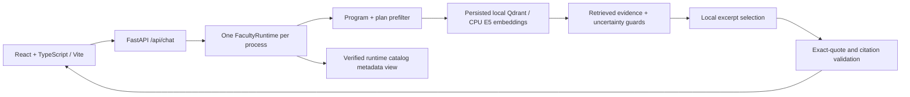

# An-Najah Engineering AI Academic Advisor

IEEE RAG Hackathon project: an Arabic/English academic advisor for the Engineering
program scopes currently indexed from An-Najah National University's official
study plans and shared undergraduate regulations.

The integrated application includes a React Frontend, a FastAPI Backend and the
existing local RAG engine. The current snapshot contains **15 program scopes and
3,832 persisted chunks**. These are the programs available in this system; the
application does not claim that every current university program is covered.

**Demo mode:** non-scripted local extractive answers, explicitly labeled as
`mode=mock` under response contract **v1.0.0**. It selects actual retrieved quotes;
it is not a local LLM and does not use an exact-question answer bank. Groq is
**not active in the web application**. Both remote API switches remain false.

## What works

- General attendance, add/drop and withdrawal regulations without selecting a program.
- Program/plan selection, exact course-code lookup, credit hours, prerequisites
  and selected-plan graduation totals, with source cards and official links.
- A bilingual program list/count derived from `runtime.programs()`, deduplicated
  by program identity rather than counting study-plan versions.
- Arabic formal and Palestinian Arabic intent handling, English course questions,
  and explicit output-language selection when verified evidence exists in that language.
- Distinct clarification, missing evidence, conflicting scope and out-of-scope responses.
- Conservative refusal for unclear prerequisite AND/OR relationships and missing cells.

The scope selector is required for course facts because the same course code can
have different credits in different plans. General university policies remain
available without a selection. Program/plan versions are never assigned from a
student's admission year automatically.

## Architecture



- Embeddings: cached `intfloat/multilingual-e5-small`, revision
  `614241f622f53c4eeff9890bdc4f31cfecc418b3`, 384 dimensions, CPU PyTorch.
- Retrieval: Qdrant Local, filtered **before ranking** by program and plan version;
  selected scopes also retain shared regulations. No global top-40 post-filtering.
- Attendance retrieval covers the existing handbook Article 10 conditions together,
  independently of question wording or question language.
- Generation: bounded local evidence selection; no academic answer constants or
  automatic translation of official evidence. The existing Groq adapter remains gated.
- Validation: returned factual claims must match actual retrieved excerpts;
  citation filenames, pages and versions come from trusted metadata.
- Concurrency: request-local scope with one serialized CPU service/index owner.
  FastAPI runs the synchronous runtime in its worker threadpool.

The catalog is a separate **in-memory view of verified runtime metadata**, not a
university PDF or a claim about the complete faculty. Its citations say this
explicitly and expose supporting official study-plan URLs. No index rebuild is
performed to answer a catalog question.

## Required local assets: a clone alone is insufficient

The Git repository and source ZIP exclude university source files, processed
datasets, Qdrant databases, model weights, private approvals, caches and secrets.
To reproduce the actual faculty demo, obtain an authorized restoration from the
project owner or separately recreate and verify the dataset from official sources.

| Asset | Current workspace path |
|---|---|
| Persisted index and bound manifests | `data/index/engineering_faculty_20261107_v1/` |
| Processed faculty evidence and metadata | `data/processed/engineering_faculty_20261107/` |
| Reviewed source pages | `data/raw/engineering_faculty_20261107/` |
| Reused handbook evidence | `data/raw/engineering_mvp_20261107/`, `data/processed/engineering_mvp_20261107/` |
| Cached embedding model | `models/multilingual-e5-small/` |
| Python environment and optional wheel cache | `.venv/`, `.cache/wheels/` |

Restore the **whole persisted index**, including `chunks.json`, `scope_manifest.json`,
`dataset_manifest.json`, retrieval bindings and its Qdrant directory. Do not merge
it with another index or edit the manifests. The runtime fails closed when
bindings, model revision or scope coverage do not match.

Never launch a second process against the same Qdrant Local directory. Use one
Backend worker and no reload. Stop the Backend before running a standalone
real-index evaluator. A source-only ZIP is not a self-contained runtime bundle.

## Environment and setup

Verified environment: Windows x64, **Python 3.11.9**, CPU PyTorch 2.8.0,
Node **22.20.0**, npm **11.11.0**. Preserve the existing working `.venv` and model.

For another authorized Windows machine, restore approved assets first. If the
virtual environment is absent, create it with Python 3.11.9 and restore the
hash-locked wheel cache:

```powershell
py -3.11 -m venv .venv
.\.venv\Scripts\python.exe -m pip install --no-index --find-links .cache\wheels --require-hashes -r requirements-phase1.lock.txt
.\.venv\Scripts\python.exe -m pip check
```

Serving additionally requires `requirements-serving.txt` (Uvicorn 0.38.0,
Click 8.3.0). If these are missing, install them from an approved local wheel
location; an authorized network install is an alternative:

```powershell
.\.venv\Scripts\python.exe -m pip install -r requirements-serving.txt
npm.cmd ci --prefix frontend
```

The latter commands can require network access. No dependency installation,
model download, source collection or embedding rebuild occurs at API startup.
Model/wheel revisions and hashes are documented in
[model manifest](docs/evidence/model_manifest.json) and
[wheel manifest](docs/evidence/wheel_manifest.json). The pinned wheel lock is
Windows-specific; a clean cross-platform installation has not been certified.

## Start the full app

From the restored project root, open two PowerShell terminals:

```powershell
# Terminal 1: Backend, one worker, cached model and existing index
.\scripts\run_final_demo.ps1 -Component backend
```

```powershell
# Terminal 2: Frontend
.\scripts\run_final_demo.ps1 -Component frontend
```

Open **http://127.0.0.1:5173/advisor**. Backend: **http://127.0.0.1:8000**.
The startup script resolves paths relative to the checkout; it does not depend
on the original `D:\rag_hackathon` drive name.

The Backend launcher sets the following process environment (it does not load `.env`):

```text
PYTHONPATH=<checkout>/src;<checkout>
RAG_INDEX_PATH=<checkout>/data/index/engineering_faculty_20261107_v1
LLM_PROVIDER=mock
ALLOW_FREE_API_CALLS=false
ALLOW_PAID_API_CALLS=false
GROQ_FREE_PLAN_CONFIRMED=false
BACKEND_LOAD_DOTENV=false
MOCK_RULES_PATH=
HF_HUB_OFFLINE=1
TRANSFORMERS_OFFLINE=1
HF_HUB_DISABLE_TELEMETRY=1
BACKEND_HOST=127.0.0.1
BACKEND_PORT=8000
BACKEND_CORS_ORIGINS=http://localhost:5173,http://127.0.0.1:5173
```

The Frontend launcher sets `VITE_API_BASE_URL=http://127.0.0.1:8000`.
Vite also proxies `/api` and `/health` for local checks. Never expose a Groq key
through a `VITE_*` variable. Public settings templates contain no credentials.

## API and examples

- `GET /health`: runtime/index readiness, provider mode and catalog count.
- `GET /api/programs`: verified programs with bilingual names and plan versions.
- `POST /api/chat`: question, selected output language and optional program/plan.
- `GET /api/sources/{document_id}`: trusted official URL/page/table/article metadata,
  or an explicitly labeled runtime-catalog metadata view.

```json
{"question":"كم ساعة مساق 10871112؟","language":"en","program_id":"civil-engineering","plan_version":"2021-1"}
```

The example selects **English output despite Arabic input**. It returns the
verified English course row for the selected plan, rather than translating a quote.
For shared rules omit both scope fields. For course questions without scope,
the advisor requests a program and plan. Responses preserve
[RAGResponse v1.0.0](docs/rag_response.schema.json): `answered`,
`insufficient_evidence`, or `error`; unanswered responses have no misleading citations.

## Evaluation and language limitations

Final verified regression: **278 Python tests passed** (one existing Starlette
deprecation warning), **10 frontend store tests passed**, and the TypeScript/Vite
production build passed. Recorded before this final improvement pass: 268 Python tests;
the preceding real-index decision evaluation passed **24/24** cases. Historical
faculty retrieval evaluation found required evidence at top-5 for **45/45**
curated answerable cases. These are bounded evaluations, not whole-corpus accuracy.

This final pass has additionally passed **40 actual frontend-store → HTTP →
Backend → faculty-index behavior checks**, including the language matrix,
catalog count/list, all requested attendance phrasings, scope clarification,
different plan credits, missing evidence and localized HTTP errors. The checks
include expected safe refusals; they do **not** claim 40 LLM-generated answers.
The [final readiness report](docs/final_demo_readiness.md) separates passed
behavior checks from unsupported English policy generation and live LLM claims.

| Input | Selected output | Bilingual course evidence | Shared Arabic-only regulations |
|---|---|---|---|
| Arabic | Arabic | Arabic source quote | Arabic source quotes |
| Arabic | English | English source quote | English explanation that verified English evidence is unavailable |
| English | Arabic | Arabic source quote | Arabic source quotes |
| English | English | English source quote | English explanation that verified English evidence is unavailable |

No English policy translation is fabricated. Cross-language policy synthesis
requires separately approved real generation or reviewed English source evidence.
Quoted facts and citations remain in their original verified form.

Run regression/build checks with the authorized environment:

```powershell
.\.venv\Scripts\python.exe -m pytest -q tests backend/tests
npm.cmd run test:store --prefix frontend
npm.cmd run build --prefix frontend
# With the actual Backend and Vite running (no remote LLM calls):
node --experimental-strip-types frontend/tests/finalHttpSmoke.mjs
```

For deeper offline real-index replay, stop the owning Backend first:

```powershell
.\.venv\Scripts\python.exe scripts\evaluate_academic_decisions.py --index data\index\engineering_faculty_20261107_v1 --output .local\academic_decision_evaluation
```

Reports stay local. See [academic decision notes](docs/academic_decisions.md)
and [faculty RAG handoff](docs/faculty_rag_handoff.md) for evidence/ownership details;
historical preparation notes in older handoffs describe earlier checkpoints.

## Groq Free status and future activation

An earlier, separately authorized faculty evaluation completed **four** actual
Groq Free attempts using `openai/gpt-oss-120b`: four answerable questions passed
source review, and an uncertain prerequisite case refused locally. That grant
is consumed. This is a small historical live test, not validation of today's
entire UI or a new permission to call the model.

The real adapter and bounded evaluator exist, with endpoint/model binding,
paid-call prohibition, no retries/fallback and attempt controls at the send boundary.
The actual web Backend currently **rejects live settings**. Safe live-browser
generation still requires a new operator Free/non-billable attestation, fresh
code/index/plan-bound approval, a server-owned persistent attempt budget and
explicit Backend integration/testing. A configuration flag or private API key
alone does not authorize or verify billing. Keep paid calls disabled.

## Official sources and redistribution

- [An-Najah Engineering faculty](https://eng.najah.edu/en/).
- [Official undergraduate program directory](https://www.najah.edu/en/academic/undergraduate-programs/).
- [Official student handbook PDF used for the indexed regulations](https://www-cdn.najah.edu/media/filer_public/d2/d2/d2d2c0d9-7ab5-408a-bccb-947bc667e202/dlyl_ltlb_25.pdf).
- [Computer Engineering study plans](https://www.najah.edu/ar/academic/undergraduate-programs/program/computer-engineering/study-plan/?study_plan=2021-1).
- Every indexed program retains its own official study-plan URL/version and
  HTML table/row or PDF page/article locator in the private bound metadata.

Public availability does not establish redistribution permission. University
PDFs/HTML, organizer guides, processed faculty data and indexes are not shipped
in Git. Only project-authored synthetic test PDFs are included, with font notices.
To recreate data from sources, review permissions and extraction quality first;
historical `scripts/faculty/` acquisition/build tools require explicit operator
actions and are not an automatic setup path. They depend on reviewed local
handbook inputs. Do not overwrite the validated index or assume a one-command
fresh-clone rebuild has been verified.

## Known limits, access and attribution

- Local extraction supports bounded intent families, not open-ended LLM reasoning.
- No access to private Zajel accounts, student records, personal eligibility,
  live exam schedules or conversational inference from unprovided records.
- Unclear prerequisite relationships, some extraction flags and handbook/plan
  discrepancies remain. Selected official plans take precedence only for their
  own facts; unsupported current-intake advice remains refused.
- Exact-quote validation proves copying/citation integrity, not semantic
  completeness or universal academic applicability. Independent review matters.
- The repository is private. Judges need an owner-granted repository access or
  the owner-delivered source-only submission ZIP; receiving that ZIP still
  requires authorized local assets to reproduce the full faculty demo.

AI assistance: **ChatGPT/Codex** assisted with code, tests, documentation,
synthetic preparation fixtures and evaluation tooling. No fine-tuning was used.
The team remains responsible for understanding, reviewing and demonstrating
the implementation. See [AI attribution](docs/ai_attribution.md).

Project source license: **GNU AGPL-3.0-only**, with [LICENSE](LICENSE), font
licenses and [third-party notices](THIRD_PARTY_NOTICES.md). Dependencies and model
weights retain their own terms and are not bundled. The historical dependency
compatibility concern documented in those notices has not been resolved by
these application changes; no blanket deployment/license clearance is claimed.
